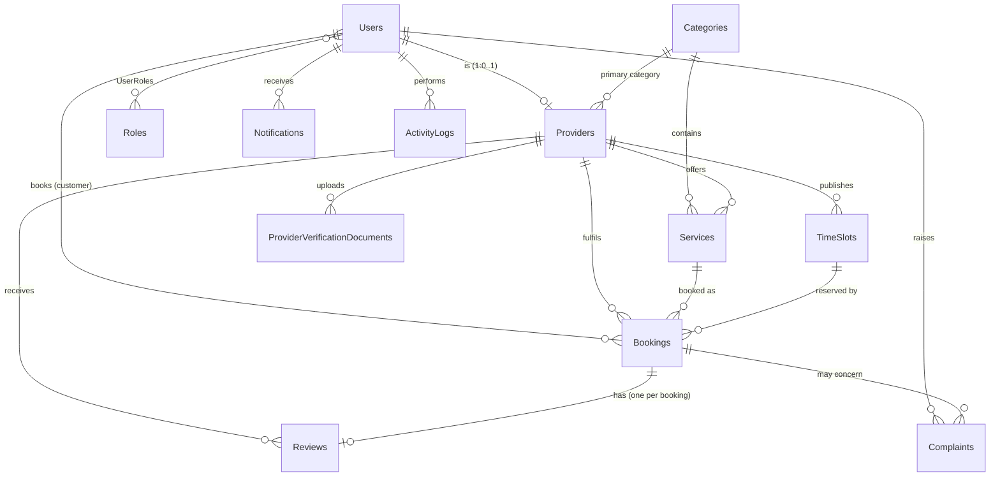

# Database design

SQL Server 2022, created entirely by **EF Core Code First migrations** (`src/LocalServicesMarketplace/Data/Migrations`):

1. `InitialCreate`: tables, keys, relationships, indexes and check constraints.
2. `AddReportingViewsAndProcedures`: 3 views and 3 stored procedures (`migrationBuilder.Sql`, one object per batch).

All timestamps are stored in **UTC** (`datetime2`). A value converter marks them as UTC when read, and the UI converts
them to IST. Money is `decimal(10,2)` on entities and `decimal(18,2)` in reports. Enums are stored as `int`.

## Entity relationship diagram

## Tables

| Table | Purpose | Notable constraints / indexes |
|---|---|---|
| `Users`, `Roles`, `UserRoles`, ... | ASP.NET Core Identity (renamed tables) + `FullName`, `City`, `IsBlocked`, `IsSampleData` | unique normalized e-mail / user name |
| `Categories` | Service categories | unique `Slug`, unique `Name` |
| `Providers` | 1:1 professional profile for a user | unique `UserId`; `CK_Providers_Rating` (0–5); index (`VerificationStatus`, `City`) |
| `Services` | Priced services a provider offers | `CK_Services_Price` (> 0), `CK_Services_Duration` |
| `TimeSlots` | Bookable windows (UTC) | unique (`ProviderId`, `StartUtc`); `CK_TimeSlots_Range` |
| `Bookings` | Customer ↔ provider bookings | **filtered unique index `UX_Bookings_ActiveSlot` on `TimeSlotId` WHERE `Status IN (0,1)`**; `RowVersion` concurrency token; `CK_Bookings_Status`, `CK_Bookings_Price`, `CK_Bookings_Schedule` |
| `Reviews` | One review per completed booking | **unique `BookingId`**; `CK_Reviews_Rating` (1–5) |
| `Notifications` | In-app notifications | index (`UserId`, `IsRead`, `CreatedAtUtc`) |
| `Complaints` | Support tickets with admin response | index (`Status`, `CreatedAtUtc`) |
| `ProviderVerificationDocuments` | Metadata of private uploads | unique `StoredFileName` |
| `ActivityLogs` | Audit trail for the admin dashboard | index `CreatedAtUtc` |

Booking status codes: `0 Pending, 1 Confirmed, 2 Completed, 3 Rejected, 4 Cancelled`.
A slot is free when it has no booking in status 0, 1 or 2.

Delete behaviour: SQL Server forbids multiple cascade paths, so most foreign keys are `RESTRICT`. The app soft-deletes
(`IsActive`, `IsBlocked`) rather than removing rows that have history.

## Views

| View | Columns (summary) | Joins |
|---|---|---|
| `TopRatedProviders` | provider, category, city, rating, reviews, completed jobs, starting price | Providers ⋈ Users ⋈ Categories (+ correlated subqueries on Bookings, Services) |
| `MonthlyBookingStatistics` | year, month, counts per status, completed value, platform revenue | Bookings grouped by month |
| `ProviderPerformance` | bookings per status, earnings, completion rate, rating | Providers ⋈ Users ⋈ Categories ⟕ Bookings |

## Stored procedures

### `dbo.CreateBooking`
Inputs: customer, provider, service, slot, address, city, notes, commission rate, minimum lead minutes, current UTC time.
Outputs: `@BookingId`, `@ResultCode`.

It runs in one transaction (`XACT_ABORT ON`) and checks, in order:
1. The customer isn't blocked.
2. The provider is approved, accepting bookings and not blocked.
3. The customer isn't booking themselves.
4. The service belongs to the provider.
5. The slot belongs to the provider and is active. The slot row is locked with **`UPDLOCK, HOLDLOCK`**.
6. The slot is far enough in the future.
7. The slot isn't already taken.
8. The customer has no overlapping active booking.

It then inserts the booking with a price snapshot and the fee split. A unique-index violation (2601/2627) or a deadlock (1205) caused by a race is reported as code 6, "slot already booked".

| Code | Meaning |
|---|---|
| 0 | success |
| 1 | customer missing or blocked |
| 2 | provider not bookable |
| 3 | invalid service |
| 4 | invalid slot |
| 5 | too soon |
| 6 | slot taken |
| 7 | self-booking |
| 8 | customer already busy at that time |

### `dbo.CalculateProviderAverageRating @ProviderId`
Recomputes `AVG(Rating)` and `COUNT(*)`, stores them on `Providers`, and returns them. It's called after each review.

### `dbo.GetMonthlyBookingReport @Year`
Returns 12 rows (a recursive month CTE LEFT JOINed to bookings), so empty months still appear. Columns: totals per status, unique customers, gross value, platform revenue and provider payouts. Used by the admin Reports page and its CSV export.
